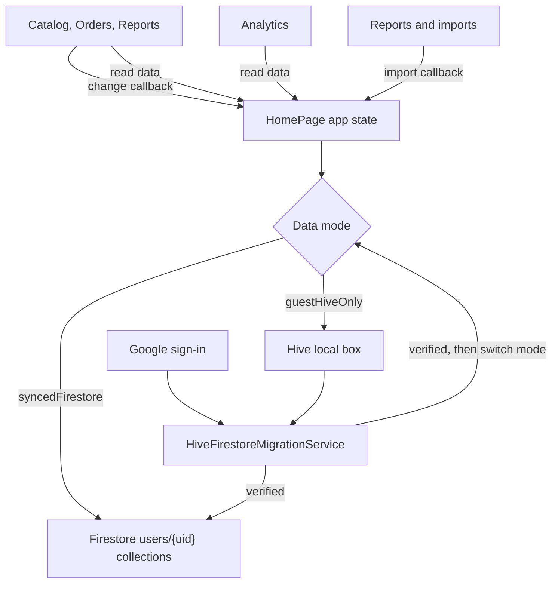

# StockPilot Inventory

StockPilot is an inventory management platform that allows users to manually track sales and inventory. The app supports Excel upload and download and generates quarterly reports containing all sales information and COGS. Profit and COGS are calculated using FIFO. The app is currently only available on Android. Hive is used for local storage, while Firebase is used for authentication and Firestore for cloud storage.

## Project Layout

```text
lib/
  app/                    App shell and basic navigation
  core/                   Platform, Firebase, and Hive configuration
  features/
    analytics/            Analytics screens
    backup_sync/          Account and backup screens
    inventory/            Inventory screens and widgets
    orders/               Order screens and widgets
    reports/              Reporting and spreadsheet features
  models/                 Hive and Firestore data objects
  services/               Hive, Firebase, Firestore, and migration services
  widgets/                Shared UI components
  main.dart               Application startup

test/                     Persistence, migration, and feature tests
assets/                   App icons
```

## Workflow
All screens read from lists owned by `HomePage` which controls the live application state of inventory, orders, and sales. All callbacks from the main screens are sent to `HomePage` where `_saveData()`, which decides whether to persist the updated lists to Hive or Firebase, is run.



### Hive
- Local/guest storage used by default
- The app uses one Hive box named `data`:
  - `INVENTORYITEMLIST` (inventory items)
  - `SALESLIST` (sales)
  - `ORDERSLIST` (orders)
  - `FOLDERCOLORS` (folder display settings)
  - `FOLDERMETA` (folder metadata)

### Firebase
- Used when in Sync mode
- Google sign-in for authentication
- Firestore collections:
  - `users/{uid}/inventory`
  - `users/{uid}/orders`
  - `users/{uid}/sales`

### Core Objects
- `InventoryItem`
- `Order`
- `InventoryOrderItem`
- `Sale`
- `SaleLineItem`

### Creation Flows

- `InventoryItem` created from UI fields
  - `HomePage` receives a callback and `_saveData()` is run
    - The inventory list is updated in Hive or Firestore
      - The app reloads the updated state

- Order created
  - Each selected `InventoryItem` becomes an `InventoryOrderItem` and is added to the order list
    - `HomePage` receives the callback and `_saveData()` runs
      - The order list is updated in Hive/Firestore, and the app reloads the state

- Sale created with FIFO cost layers in `priceBreakdown`
  - The sale is added to the inventory item
    - The global `saleList` is updated and saved to Hive/Firestore

### Editing Items
This includes editing objects and moving folders (editing folder metadata).

- Local data objects are modified
  - `HomePage` receives the callback and `_saveData()` runs
    - Firebase or Hive is updated, and the app refreshes state

#### Example

- Change an item's price from $5 to $7 in `EditInventoryPage`:
  - The edit screen updates the shared `InventoryItem` object and calls its update callback to `HomePage`.
  - `CatalogPage` refreshes and calls `onDataChanged`, which invokes `HomePage._saveData()`.
  - `HomePage` refreshes its list references and saves the current data:
    - In guest mode, `HiveService` writes the inventory, sales, and orders to the `data` box.
    - In synced mode, `FirestoreAppDataStore` writes the descriptive item change, including its price, to `users/{uid}/inventory/{itemId}`.
  - The catalog rebuilds using the updated item.

### Syncing and Migration Flow

- User signs in through Firebase
  - The app checks whether migration is verified
    - If not, Hive data is copied to Firestore
    - If verified, the app is marked as "synced"
      - Firestore is now used for all reads and writes unless the user signs out

`Data_Mode` saves selected storage mode in SharedPreferance, under `guestHiveOnly` and `syncedFirestore`. `MigrationStateStore` records whether the user's Hive data was succesfully migrated to Firestore. Additionally, a pending user ID is saved if a migration needs to be retried. Stock Pilot only switches to using Firestore once migration is successful.


